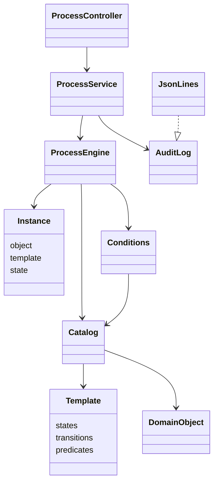

# MOPS — конфигурируемый движок процессов

Общая часть задания 3-1-1 на Java 27 и Spring Boot. В комплекте — демонстрационная
модель закупки оборудования. Классы, объекты, пользователи, состояния, действия
и правила подключаются через YAML.
Поддерживаются наследование параметров и составность объектов одновременно.

Для запуска нужны JDK 27 и Gradle Wrapper из репозитория. База данных не нужна.

```bash
./gradlew bootRun
```

Откройте **http://localhost:8080/**. Страница позволяет выбрать пользователя и объект,
запустить процесс и выполнить действие. На диаграмме подсвечиваются текущее состояние
и последний выполненный переход. Ниже показаны параметры объекта и условия переходов.
Диаграмма строится из модели в браузере на SVG, внешние сервисы и CDN не нужны.
JSON последней команды доступен в сворачиваемом блоке.

Для первого знакомства оставьте пользователя «Демонстратор — все роли» и объект
«Монитор и принтер для офиса». Нажмите «Запустить процесс», затем выполните
«Отправить на согласование» → «Согласовать» → «Подтвердить получение».
Дорогая заявка «Рабочее место разработчика» дополнительно проходит проверку бюджета.
Подробнее: [демонстрационные сценарии](docs/purchase-example.md).

Свою модель можно подключить так:

```bash
MOPS_MODEL=file:/absolute/path/model.yaml ./gradlew bootRun
```

`MOPS_MODEL` задаёт ресурс Spring (`file:/...` либо `classpath:...`), по умолчанию —
`classpath:process-model.yaml`. В одном файле находятся разделы `classes`, `objects`,
`roles`, `users`, `processes`. Их формат описан в [docs/configuration.md](docs/configuration.md).

Объекты загружаются при старте; процессы запускаются отдельными командами. Шаблон
общий для всех объектов класса. Запись запуска хранит только идентификаторы объекта,
шаблона и текущее состояние. Рабочие данные находятся в памяти. Перезапуск загружает
исходные объекты и очищает запуски, журнал для восстановления не используется.

Журнал по умолчанию — `logs/processes.jsonl`, путь меняется переменной `MOPS_AUDIT`.
Файл дополняется, каждая обработанная команда немедленно записывается отдельной
JSON-строкой: исходная команда, пользователь, объект, состояния до и после,
результат (`accepted`, `rejected`, `error`) и причина отказа/ошибки. Для некорректного
JSON исходная команда сохраняется строкой. Ошибка записи журнала передаётся вызывающей стороне.

## API

| Метод | Путь | Назначение |
|---|---|---|
| GET | `/api/processes/model` | Исходная модель |
| GET | `/api/processes/objects` | Объекты с применёнными значениями по умолчанию |
| GET | `/api/processes` | Запущенные процессы и их текущие состояния |
| POST | `/api/processes/commands` | Обработать команду и записать результат в журнал |

Формат команд (идентификаторы замените на свои):

```json
{"type":"start","user":"user-id","object":"object-id"}
{"type":"action","user":"user-id","object":"object-id","action":"action-id"}
```

```bash
curl -X POST http://localhost:8080/api/processes/commands \
  -H 'Content-Type: application/json' \
  -d '{"type":"start","user":"user-id","object":"object-id"}'
```

Результат обработанной команды возвращается с HTTP 200; статус выполнения смотрите
в поле `result`. Это позволяет одинаково читать успех, отказ и ошибку. При отказе
и неоднозначности перехода состояние не меняется. Команды выполняются последовательно,
обработка команды и чтение списка запусков синхронизированы на сервисе.

## Устройство

- `model/Model` — описания классов, параметров, объектов, пользователей и шаблонов;
  `Instance` — минимальная запись запуска, без копии правил.
- `model/Catalog` — каталог моделей, разрешение наследования, полное переопределение
  параметров и применение `default` только к пропущенным скалярным полям.
- `process/Conditions` — интерпретатор ДНФ. Выражения компилируются один раз, вычисляются
  при каждой команде. Агрегаторы `all` и `any` выбираются по имени из реестра функций.
  Для добавления стратегии передайте новую функцию в конструктор `Conditions`, затем
  этот интерпретатор в `ProcessEngine`; код переходов изменять не нужно.
- `process/ProcessEngine` — запуск и выбор единственного разрешённого перехода с проверкой
  ролей. Состояние хранится отдельно от общего шаблона и предметных параметров объекта.
- `process/ProcessService` — разбор запросов в команды `Start`/`Action`, обработка результатов
  и единая точка аудита; реализация `AuditLog` передаётся через конструктор.
- `process/AuditLog.JsonLines` — дописывание JSONL с немедленным сбросом буфера.
- `config/ProcessConfiguration`, `api/ProcessController` — подключение файлов и HTTP-интерфейс.



Изменение модели требует изменения YAML и перезапуска, а не обработчика переходов.
Полная валидация конфигурации не реализуется: ожидаются корректные ссылки, типы и
структура. Проверяются дубликаты основных идентификаторов, циклы наследования,
сохранение типа при переопределении, единственность шаблона класса и начального
состояния, операторы, агрегаторы и ссылки на предикаты условий. Границы значений
проверяются при переходе, загрузке объектов они не препятствуют.

## Проверка

```bash
./gradlew test
```

Отчёт: `build/reports/tests/test/index.html`. Тесты проверяют маршруты с возвратом,
роли и условия, обе группы ДНФ, отрицание, неоднозначность, наследование и составность,
незаданные значения, агрегаторы, JSONL и REST без БД. Техническая модель для тестов —
[src/test/resources/engine-model.yaml](src/test/resources/engine-model.yaml).
Она демонстрирует контракт формата и не задаёт вашу предметную область.
При необходимости её можно подключить вручную:

```bash
MOPS_MODEL=file:./src/test/resources/engine-model.yaml ./gradlew bootRun
```

Для неё основной путь: `author / good / start`, `author / good / send`,
`reviewer / good / accept` → `done`. Для возврата перед `accept` выполните
`reviewer / good / back`. Действие `accept` от `author` отклоняется по роли;
`send` для объектов `big` или `bad_part` — по условию.
