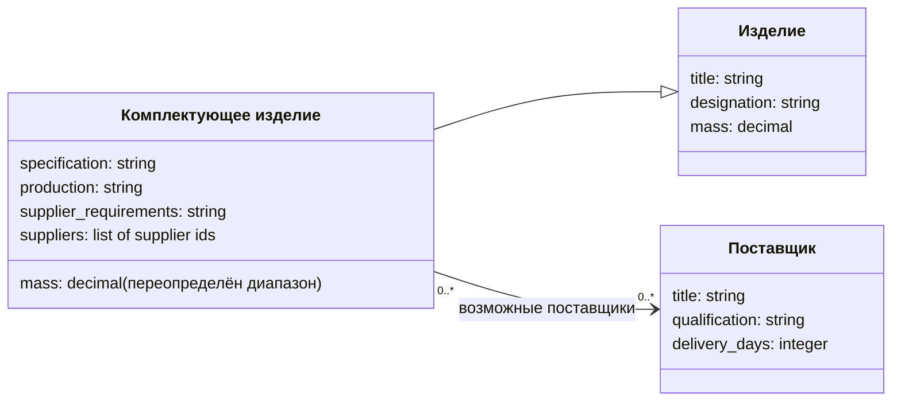
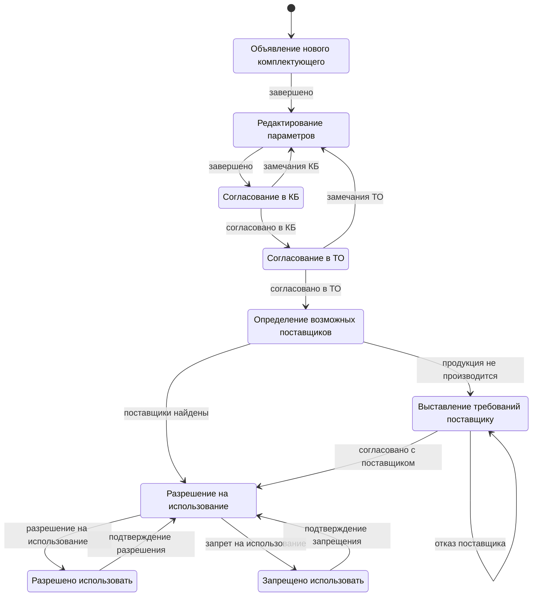

# Вариант 1. Включение нового комплектующего в справочник

## Границы модели

Цель процесса — рассмотреть новое комплектующее, согласовать его технические
характеристики и условия снабжения, затем принять решение о возможности использования.
Объект процесса — **комплектующее изделие**, а не заявка на закупку и не поставщик.
Шаблон `component_introduction` привязан непосредственно к классу `component`.

Состояния, направления переходов и действия взяты из рисунка 1 задания 3-1-1.
Состав параметров, роли участников, числовые ограничения и предикаты ниже —
предлагаемые проектные решения: исходная диаграмма их не устанавливает.
В частности, предел массы 50 кг и срок поставки 90 дней — учебные ограничения,
а не отраслевые нормативы.

Результат рассмотрения — состояние «Разрешено использовать» или «Запрещено
использовать». **Они не конечные**: по исходной диаграмме из обоих состояний можно
вернуться к принятию решения. Команды «Подтверждение разрешения» и «Подтверждение
запрещения» сохраняют именно направления стрелок задания, хотя их названия могут
восприниматься как завершение проверки. После возврата допускается новое решение.

## Классы и связи

`Item` и `Component` соответствуют базовому изделию и комплектующему на рисунке 4
задания. Классы продукции и позиции состава нужны для описания спецификаций;
в выбранном процессе их параметры не используются, поэтому в исполняемую модель
первого варианта они не включены. Добавлен поставщик, поскольку его выбор и
согласование условий явно присутствуют в процессе первого варианта.

Связь с поставщиками — составность в смысле задания: ссылки на самостоятельные
объекты. Это не владение жизненным циклом поставщика. Один поставщик может
участвовать в рассмотрении нескольких комплектующих. До этапа выбора допускается
пустой список; для перехода к разрешению требуется от одного до пяти поставщиков.

### Изделие — `item`

| Параметр | Тип | Назначение и ограничения |
|---|---|---|
| `title` | string | Наименование изделия |
| `designation` | string | Обозначение изделия |
| `mass` | decimal | Масса в кг, от 0,001 до 10 000 |

### Комплектующее — `component`, наследник `item`

| Параметр | Тип | Назначение и ограничения |
|---|---|---|
| `title` | string | Наследуется без изменения |
| `designation` | string | Наследуется без изменения |
| `mass` | decimal | Полное переопределение: от 0,001 до 50 кг |
| `specification` | string | Ссылка на спецификацию/чертёж или техническое описание |
| `production` | string | `серийное` по умолчанию либо `под заказ` |
| `supplier_requirements` | string | Подготовленные требования к заказному изготовлению; без default |
| `suppliers` | supplier | Список id поставщиков; количество для проверки: 1–5; без значения — `[]` |

Скалярные поля без `default` остаются `null`, если пропущены. Явный `null` не
заменяется значением по умолчанию. Тип массы при переопределении сохраняется.
Объект массой 75 кг допустим для базового изделия, но предикат комплектующего
отклоняет его при завершении редактирования. Загрузка такого объекта разрешена.

### Поставщик — `supplier`

| Параметр | Тип | Назначение и ограничения |
|---|---|---|
| `title` | string | Наименование организации |
| `qualification` | string | `подтверждена` по умолчанию либо `не подтверждена` |
| `delivery_days` | integer | Срок поставки 1–90 дней, по умолчанию 30 |

Квалификация означает результат предварительной проверки поставщика. В учебной
модели проверка не исполняется отдельным процессом — её результат уже задан.
Наборы значений `production` и `qualification` — соглашение конфигурации;
универсальный движок хранит строки и не содержит этих перечислений в коде.

## Участники и полномочия

| Роль | Пользователь | Обязанности |
|---|---|---|
| `engineer` — инженер-инициатор | `anna` | Запуск процесса, объявление и подготовка параметров |
| `kb` — согласующий КБ | `boris` | Конструкторская проверка, согласование или замечания |
| `technology` — согласующий ТО | `tatiana` | Технологическая проверка, согласование или замечания |
| `procurement` — снабжение | `oleg` | Выбор поставщиков, подготовка требований, фиксация исхода переговоров |
| `approver` — ответственный за допуск | `irina` | Разрешение, запрет и повторное рассмотрение |

Пользователь `demo` имеет все пять ролей для демонстрации. Право определяется
ролью текущего состояния; для запуска требуется `engineer`. Проверки пароля нет.

## Состояния процесса

| Состояние | Роль | Смысл |
|---|---|---|
| `declared` | engineer | Комплектующее объявлено для рассмотрения; начальное состояние |
| `editing` | engineer | Подготовка технических данных |
| `review_kb` | kb | Рассмотрение конструкторским бюро |
| `review_to` | technology | Рассмотрение технологическим отделом |
| `suppliers` | procurement | Определение способа снабжения |
| `requirements` | procurement | Согласование заказного изготовления |
| `permission` | approver | Принятие решения о допуске |
| `allowed` | approver | Использование разрешено, возможно повторное рассмотрение |
| `forbidden` | approver | Использование запрещено, возможно повторное рассмотрение |

## Предикаты и правила переходов

| Предикат | Проверка |
|---|---|
| `title_filled` | Наименование задано |
| `designation_filled` | Обозначение задано |
| `mass_valid` | Масса соответствует диапазону класса комплектующего |
| `specification_filled` | Техническая спецификация задана |
| `serial_production` | `production = серийное` |
| `custom_production` | `production = под заказ` |
| `requirements_filled` | Требования к изготовлению заданы |
| `supplier_count_valid` | Число поставщиков находится в диапазоне 1–5 |
| `suppliers_qualified` | `all`: у каждого поставщика квалификация подтверждена |
| `delivery_terms_valid` | `all`: у каждого поставщика срок соответствует его классу |

`filled` используется по контракту задания: проверяет наличие значения, пустая
строка считается заданной. Это не проверка полноты содержания технического документа.

| Откуда → куда | Действие | Условие |
|---|---|---|
| declared → editing | `complete` | Без дополнительного условия |
| editing → review_kb | `complete` | Наименование И обозначение И спецификация заданы, масса допустима |
| review_kb → editing | `kb_comments` | Без дополнительного условия |
| review_kb → review_to | `kb_approve` | Без дополнительного условия |
| review_to → editing | `technology_comments` | Без дополнительного условия |
| review_to → suppliers | `technology_approve` | Без дополнительного условия |
| suppliers → permission | `suppliers_found` | Серийное производство И допустимое число поставщиков И все квалифицированы И сроки допустимы |
| suppliers → requirements | `not_produced` | Изготовление под заказ |
| requirements → requirements | `supplier_refusal` | Без дополнительного условия; повторные переговоры |
| requirements → permission | `supplier_agreement` | Требования заданы И допустимое число поставщиков И все квалифицированы И сроки допустимы |
| permission → allowed | `allow` | ДНФ разрешения, описанная ниже |
| permission → forbidden | `forbid` | Без дополнительного условия; решение ответственного |
| allowed → permission | `confirm_allowance` | Без дополнительного условия |
| forbidden → permission | `confirm_prohibition` | Без дополнительного условия |

Во всех строках дополнительно проверяются роль и текущее состояние. Согласование
КБ, ТО и решение о запрете — явные решения пользователя; движок не подменяет
экспертную оценку собственным алгоритмом.

**ДНФ разрешения.** Обозначим `S` — серийное производство, `C` — изготовление под
заказ, `R` — требования заданы, `N` — число поставщиков допустимо, `Q` — все
квалифицированы, `D` — сроки допустимы. Тогда разрешение возможно при:

`(S И N И Q И D) ИЛИ (C И R И N И Q И D)`.

Первая группа используется для серийного комплектующего, вторая — для заказного.
Незаполненное либо неизвестное значение способа изготовления не удовлетворяет
ни одной группе. Запрет остаётся самостоятельным действием ответственного.

Агрегатор `all` на пустой последовательности истинен, поэтому он обязательно
сочетается с отдельной проверкой числа поставщиков. Квалификация проверяется у
**каждого** из нескольких поставщиков — одного подтверждённого недостаточно.

## Готовые данные и сценарии проверки

| Объект | Назначение |
|---|---|
| `component-bearing` | Серийный подшипник с двумя квалифицированными поставщиками; основной маршрут |
| `component-custom` | Заказная втулка с подготовленными требованиями; ветка переговоров и вторая группа ДНФ |
| `component-overweight` | Масса 75 кг; отказ при завершении редактирования, демонстрация переопределения |
| `component-no-suppliers` | Пустой состав поставщиков; отказ на их выборе |
| `component-unqualified` | Из двух поставщиков один не квалифицирован; отказ по `all` |
| `component-slow-delivery` | Срок поставки 120 дней; отказ по параметру объекта состава |
| `component-no-requirements` | Заказное изделие без требований; отказ при согласовании с поставщиком |

Основной маршрут: `start` → `complete` → `complete` → `kb_approve` →
`technology_approve` → `suppliers_found` → `allow`. Результат — `allowed`.
Это выбранный результат демонстрации, а не завершение жизненного цикла процесса.

Для ветки изготовления под заказ замените `suppliers_found` на `not_produced`,
затем выполните `supplier_refusal` (состояние не изменится), `supplier_agreement`
и `allow`. Для возврата выполните `kb_comments` или `technology_comments` в
соответствующем состоянии и снова пройдите этапы согласования.

Для отказа по роли попробуйте `kb_approve` от `anna` в состоянии `review_kb`;
затем повторите от `boris`. При отказе состояние сохраняется. Каждая команда,
включая петлю и отказ, должна иметь запись в JSONL с состояниями до и после.

## Допущения учебного исполнения

Объекты и предполагаемые поставщики заранее описаны в конфигурации. Действия
редактирования и переговоров переводят процесс между этапами, но не изменяют
параметры объектов. Команда «Согласовано с поставщиком» фиксирует решение
пользователя при наличии подготовленных данных; отдельного поля «уже согласовано»
нет. Аналогично допуск определяется состоянием процесса, а не дублирующим флагом.

При отказе из-за неполных исходных данных исправляют конфигурацию и перезапускают
программу. Редактор объектов, реальные переговоры, интеграции со справочниками,
изменение состава и ведение спецификаций не входят в реализацию задания.

У каждого комплектующего максимум один запущенный процесс. Все запуски используют
один шаблон; отдельная запись хранит только идентификатор объекта, идентификатор
шаблона и текущее состояние. Поставщики собственных процессов не имеют.
