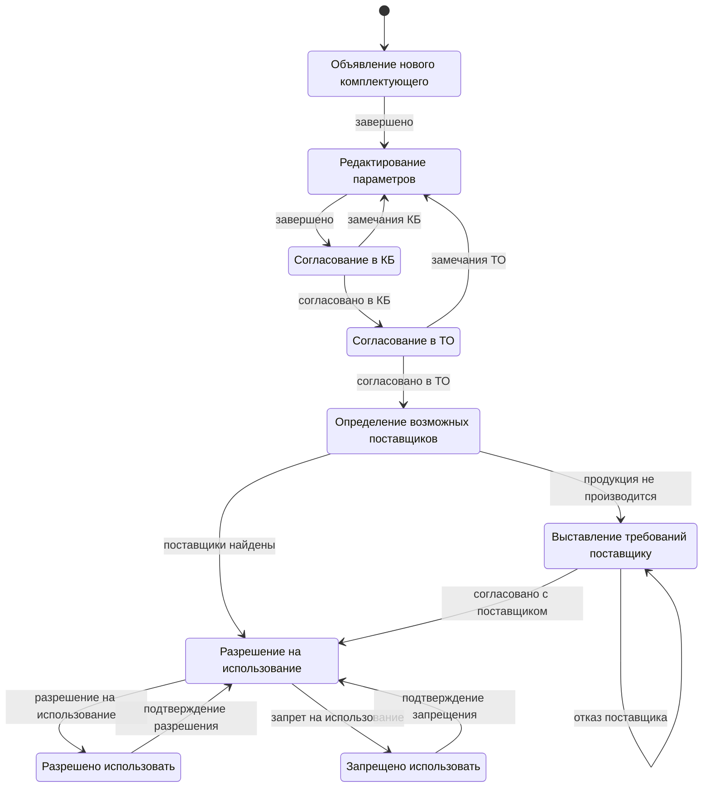
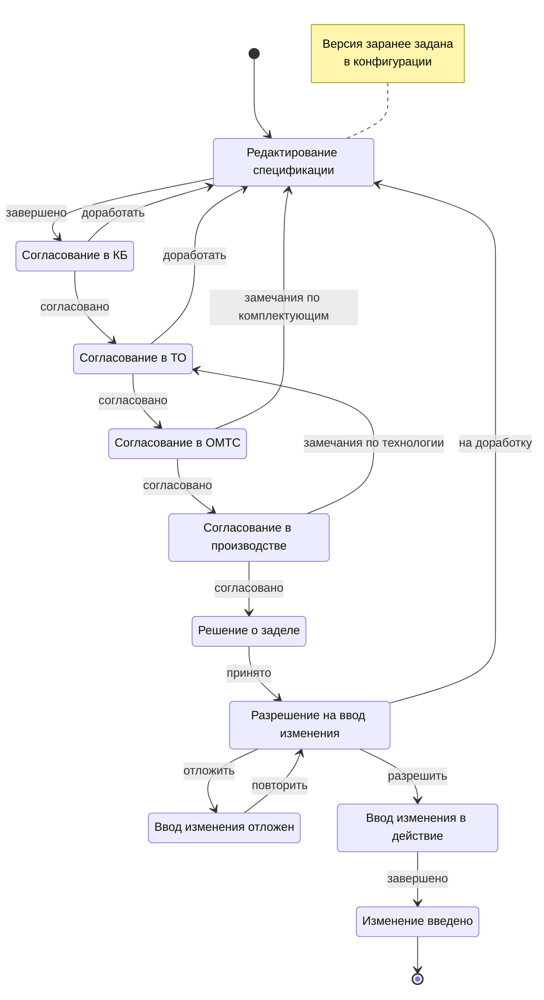
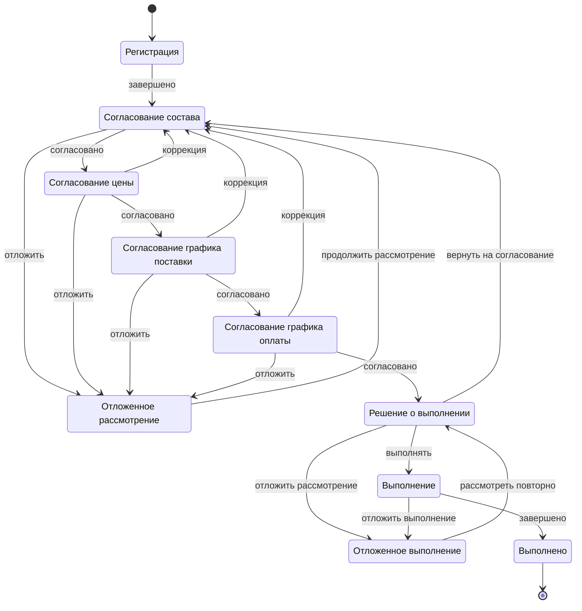
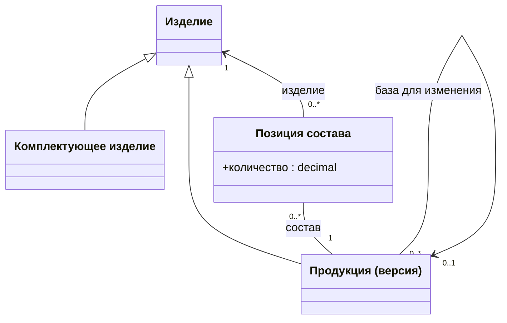
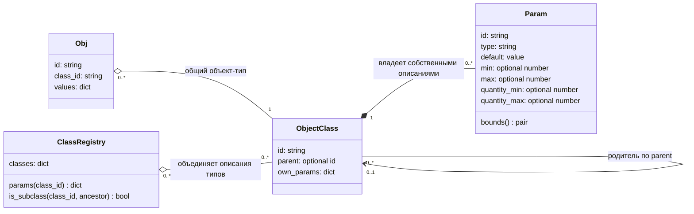
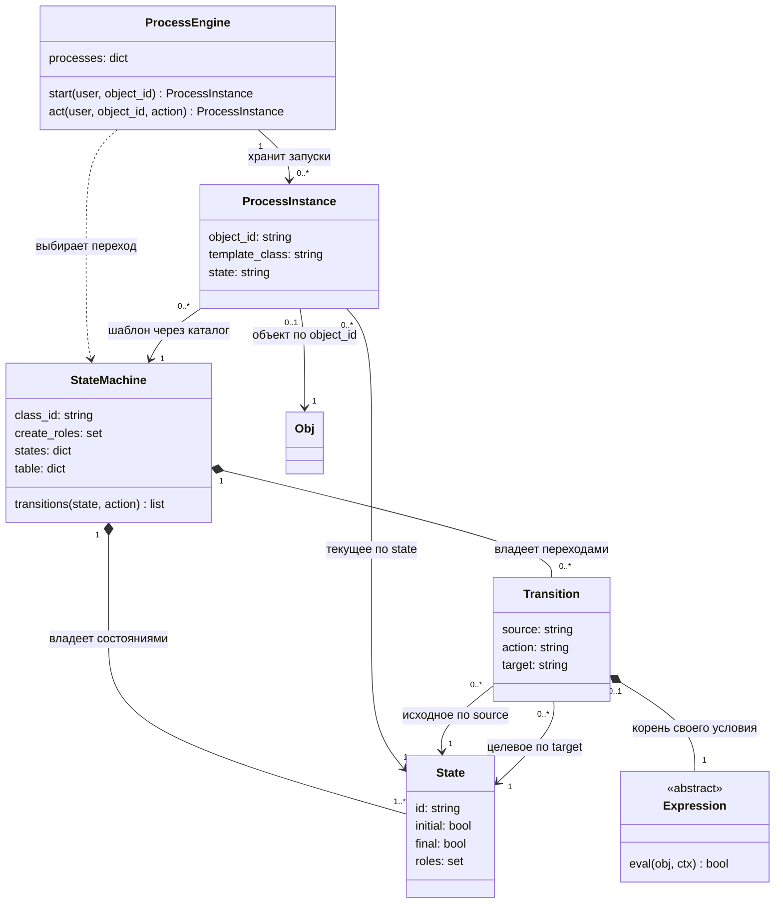
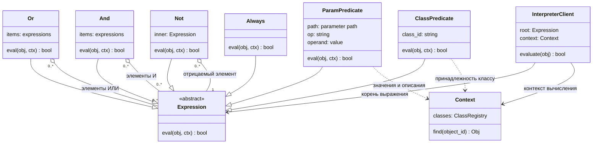
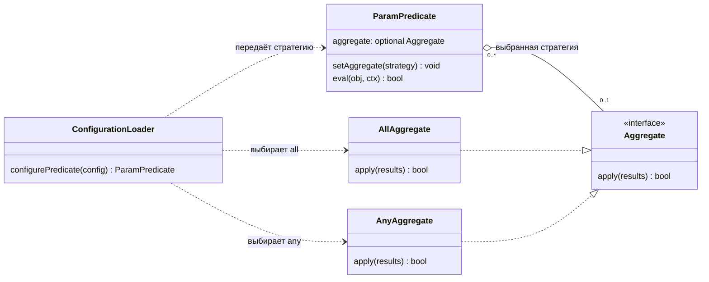
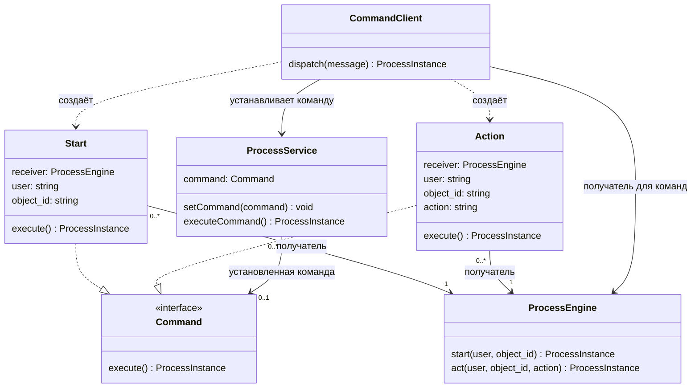
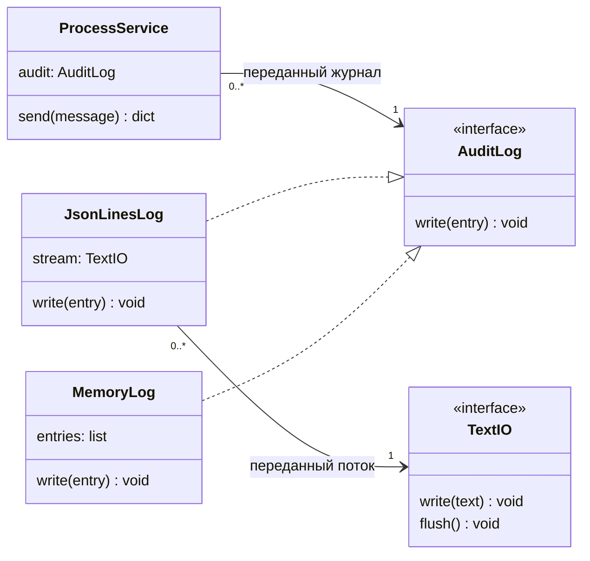

# Задание 3-1-1. Приемы моделирования бизнес-логики

**Дисциплина:** Модели объектов и процессов информационных систем.  
**Форма работы:** бригада из 3-4 человек.  
**Форма оценивания:** очная защита по функциональности, архитектуре и реализации системы.  
**Требования к выставлению оценки:** распечатанный титульный лист отчёта и полный отчёт в электронном виде.  

### Задание

Разработать программную систему описания и исполнения процессов над объектами предметной области на основе конфигурируемых моделей.

Обеспечить:
1. Описание классов объектов, их параметров и исходных объектов в конфигурации.
2. Описание шаблонов процессов: состояний, действий, переходов, ролевых ограничений и условий переходов в дизъюнктивной нормальной форме (ДНФ).
3. Создание экземпляра процесса по шаблону, непосредственно связанному с классом выбранного объекта.
4. Исполнение процесса с проверкой допустимости действия, полномочий пользователя и условий перехода.
5. Поддержку хотя бы одного механизма организации объектной модели: наследования параметров классов или составности объектов. Допускается совместная реализация обоих механизмов.
6. Регистрацию результатов обработки команд, включая успешное выполнение, отказы и ошибки, в журнале формата JSON или JSONL.
7. Проверку работоспособности системы на выбранном примере процесса.

Описание моделей должно быть отделено от общего механизма их исполнения. Названия классов, состояний, действий и правила конкретного варианта не должны быть зашиты в обработчик переходов. Команды можно обрабатывать синхронно; очередь не обязательна.

Объекты заранее описаны в конфигурации. Пользователь отдельной командой запускает процесс над существующим объектом. Рабочие данные и состояния процессов находятся в памяти: после перезапуска программа загружает исходные данные заново. Сохраняется только лог; восстановление процессов из него не требуется.

### Цель работы

Освоить принципы моделирования и программной реализации бизнес-логики информационных систем на основе моделей объектов и процессов, допускающих исполнение.

При выполнении работы приобрести навыки:
- представления структуры объектов и правил выполнения процессов в конфигурации;
- разработки общего механизма исполнения процессов с ролевыми ограничениями и логическими условиями переходов;
- применения наследования параметров классов, составности объектов или обоих механизмов совместно;
- обоснования архитектурных решений с использованием UML и паттернов проектирования;
- проверки соответствия реализации заданным требованиям.

### Объём работы

Различайте три понятия: **объект** содержит параметры предметной области; **шаблон процесса** описывает общие правила; **экземпляр процесса** связывает объект с шаблоном и хранит текущее состояние. Загруженный объект ещё не означает запущенный процесс.

Необходимо реализовать **хотя бы один механизм: наследование параметров классов или составность объектов. Можно реализовать оба одновременно. Выбор одного механизма не ограничивает максимальную оценку.** Пример ниже иллюстрирует оба механизма. Если выбрано только наследование, уберите параметры-составы, предикаты по ним и ссылки на эти предикаты в условиях. Если выбрана только составность, описывайте все параметры каждого класса явно, без `parent`.

Язык программирования — по выбору бригады. Готовые системы управления процессами (Camunda, Flowable и т. п.) не используются.

**Для курсовой работы:** достаточно интерфейса выбора пользователя из конфигурации, запуска процесса над существующим объектом и выполнения действий с демонстрацией отказов по условиям и ролям. Продемонстрируйте путь до конечного состояния либо до выбранного результата, если конечных состояний нет. Конструктор объектов, редактор параметров и проверка пароля не требуются.

## 1. Пример конфигурации

Пример не относится к вариантам. YAML выбран для наглядности; формат конфигурации можно выбрать свой при том же содержании. База данных не требуется.

### 1.1. Классы объектов — `classes.yaml`

```yaml
# Параметр подкласса с тем же id полностью заменяет параметр родителя.
# default — подставляется, если поле пропущено; явный null остаётся незаданным.
classes:
  - id: design_document
    title: Конструкторский документ
    parameters:
      - id: designation
        title: Обозначение
        type: string
      - id: sheets
        title: Число листов
        type: integer
        min: 1
        max: 50
        default: 1
      # Этот параметр нужен при выборе составности.
      - id: gearboxes # ссылки на редукторы, описанные документом: тип — класс, значение — список id
        title: Редукторы
        type: gearbox
        quantity_max: 4

  - id: drawing
    title: Чертеж
    # При выборе только составности перечислите параметры родителя здесь явно.
    parent: design_document # наследование
    parameters:
      - id: sheets # переопределен целиком после наследования: другой диапазон, default повторен
        title: Число листов
        type: integer
        min: 1
        max: 20
        default: 1
      - id: mass # новый параметр, без значения по умолчанию
        title: Масса, кг
        type: decimal
        min: 0.1
        max: 500
      - id: review_mode
        title: Режим проверки
        type: string
        default: normal

  - id: diagram
    title: Схема
    parent: design_document # параметры наследуются без изменений

  - id: gearbox
    title: Редуктор
    parameters:
      - id: ratio
        title: Передаточное число
        type: decimal
        min: 1
        max: 100
      - id: gears # у параметра-состава указан класс связанных объектов
        title: Шестерни
        type: gear
        quantity_min: 2
        quantity_max: 6
      - id: bearings
        title: Подшипники
        type: bearing
        quantity_min: 2 # верхняя граница не задана и, соответственно, не проверяется

  - id: gear # простые объекты: составов внутри нет
    title: Шестерня
    parameters:
      - id: teeth
        title: Число зубьев
        type: integer
        min: 10
        max: 200
      - id: module
        title: Модуль, мм
        type: decimal
        min: 0.5
        max: 10
        default: 2

  - id: bearing
    title: Подшипник
    parameters:
      - id: designation
        title: Условное обозначение
        type: string
        default: "6204"
```

### 1.2. Начальные объекты — `objects.yaml`

```yaml
# Пропущенные скалярные поля получают default; явный null не заменяется.
objects:
  - id: gear-1
    class: gear
    values:
      teeth: 20
      # module = 2 по умолчанию
  - id: gear-2
    class: gear
    values:
      teeth: 63
      module: 2.5 # задан явно вместо значения по умолчанию
  - id: gear-3
    class: gear
    # teeth = null: поле пропущено, значения по умолчанию нет
  - id: bearing-1
    class: bearing
    # designation = "6204" по умолчанию
  - id: bearing-2
    class: bearing
  - id: bearing-3
    class: bearing
    values:
      designation: "6205"
  - id: bearing-4
    class: bearing
    values:
      designation: "6205"

  - id: gb-1
    class: gearbox
    values:
      ratio: 3.15
      gears: [gear-1, gear-2] # идентификаторы заранее описанных объектов
      bearings: [bearing-1, bearing-2]

  - id: gb-2 # неполный: одна шестерня при минимуме 2
    class: gearbox
    values:
      ratio: 2.5
      gears: [gear-3]
      bearings: [bearing-3, bearing-4]

  - id: drw-1
    class: drawing
    values:
      designation: АБВГ.123456.001
      sheets: 12
      gearboxes: [gb-1]
  - id: drw-too-large
    class: drawing
    values:
      designation: АБВГ.123456.002
      sheets: 30 # загрузка разрешена; ограничение проверяется при переходе
      gearboxes: [gb-1]
  - id: drw-small
    class: drawing
    values:
      designation: АБВГ.123456.003
      sheets: 2
  - id: drw-incomplete
    class: drawing
    values:
      designation: АБВГ.123456.004
      gearboxes: [gb-2]
  - id: drw-simplified
    class: drawing
    values:
      designation: АБВГ.123456.005
      sheets: 5
      review_mode: simplified
  - id: drw-mandatory
    class: drawing
    values:
      designation: АБВГ.123456.006
      sheets: 2
      review_mode: mandatory
```

### 1.3. Роли и пользователи — `users.yaml`

```yaml
roles:
  - id: developer
    title: Разработчик
  - id: normcontroller
    title: Нормоконтролер
  - id: chief_designer
    title: Главный конструктор

users:
  - id: ivanov
    name: Иванов И. И.
    roles: [developer]
  - id: petrov
    name: Петров П. П.
    roles: [normcontroller]
  - id: sidorov
    name: Сидоров С. С.
    roles: [chief_designer, normcontroller] # одновременно имеет несколько ролей, т.е. больше прав
```

### 1.4. Шаблон процесса — `document_approval.yaml`

```yaml
process: document_approval
title: Утверждение документа
class: drawing # только объекты этого класса; шаблоны не наследуются
create_roles: [developer] # кто может создавать процесс

actions:
  - id: submit
    title: Передать на проверку
  - id: cancel
    title: Аннулировать
  - id: accept
    title: Принять
  - id: reject
    title: Вернуть с замечаниями
  - id: approve
    title: Утвердить

predicates:
  - id: has_designation
    parameter: designation # левый операнд
    operator: filled # "обозначение задано", унарный оператор, не требует правого операнда
  - id: sheets_in_range
    parameter: sheets
    operator: in_range # число листов соответствует диапазону поля класса (min max)
  - id: small_document
    parameter: sheets # левый операнд
    operator: <= # сам оператор
    value: 2 # не более 2 листов. 2 - правый операнд
  - id: simplified_review
    parameter: review_mode
    operator: '='
    value: simplified
  - id: mandatory_review
    parameter: review_mode
    operator: '='
    value: mandatory
  - id: gearboxes_complete
    parameter: gearboxes.gears # путь к параметрам объектов, из которых состоит сложный объект
    # У каждого редуктора число шестерен в диапазоне его класса.
    # Агрегатор объединяет результаты проверок связанных объектов.
    # all возвращает true, если проверка истинна для каждого объекта.
    aggregate: all
    operator: in_range

states:
  - id: preparation
    title: Подготовка
    initial: true
    roles: [developer] # кто выполняет действия в этом состоянии
  - id: normcontrol
    title: Нормоконтроль
    roles: [normcontroller]
  - id: approval
    title: Утверждение
    roles: [chief_designer]
  - id: approved
    title: Утвержден
    final: true
  - id: cancelled
    title: Аннулирован
    final: true

# Условие — список дизъюнктов (с оператором между ними «ИЛИ»),
# где каждый дизъюнкт — внутренний список предикатов (с оператором между ними «И»).
transitions:
  - from: preparation
    action: submit
    to: normcontrol
    condition:
      - [has_designation, sheets_in_range, gearboxes_complete] # Между ними отношение только "И"
  - from: preparation
    action: cancel
    to: cancelled
  - from: normcontrol
    action: reject
    to: preparation
  - from: normcontrol # упрощённое утверждение, если полная проверка не обязательна
    action: accept
    to: approved
    condition:
      - [small_document, not mandatory_review]
      - [simplified_review, not mandatory_review]
  - from: normcontrol # остальные — главному конструктору
    action: accept
    to: approval
    condition:
      - [mandatory_review]
      - [not small_document, not simplified_review]
  - from: approval
    action: approve
    to: approved
  - from: approval
    action: reject
    to: preparation
```

### 1.5. Пример демонстрации работы в логе

**Как работает ДНФ в примере.** `review_mode` задаётся в готовом объекте: `normal` — обычный порядок, `simplified` — заранее разрешённый упрощённый порядок, `mandatory` — обязательная проверка главным конструктором. Это учебное бизнес-правило.

Обозначим: **A** — не более двух листов, **B** — разрешён упрощённый порядок, **C** — обязательна полная проверка. Переход `accept → approved` разрешён при **(A И НЕ C) ИЛИ (B И НЕ C)**. Каждая строка `condition` — отдельная группа «И», между строками — «ИЛИ»; `not` отрицает один предикат.

Противоположное условие для `accept → approval`: **C ИЛИ (НЕ A И НЕ B)**. Оно получено по законам де Моргана, поэтому два перехода не срабатывают одновременно. Даже если несколько групп одного условия истинны, это один разрешённый переход.

| Листы | Режим | Результат `accept` |
|---|---|---|
| 2 | `normal` | `approved`: первая группа |
| 5 | `simplified` | `approved`: вторая группа |
| 2 | `simplified` | `approved`: обе группы одного условия |
| 2 | `mandatory` | `approval`: полная проверка обязательна |
| 5 | `normal` | `approval`: ни одно основание для упрощения не выполнено |

Объекты из раздела 1.2 загружены, процессы ещё не запущены. Каждая строка следующей таблицы выполнения соответствует одной команде и одной записи лога. Первые две команды показаны ниже; каждая строка — отдельное JSON-сообщение.

```json
{"type": "start", "user": "ivanov", "object": "drw-1"}
{"type": "action", "user": "ivanov", "object": "drw-1", "action": "submit"}
```

| № | Пользователь | Объект | Команда | Результат | Состояние после команды |
|:-:|---|---|---|---|---|
| 1 | ivanov | drw-1 | start | Процесс запущен | preparation |
| 2 | ivanov | drw-1 | submit | Переход выполнен | normcontrol |
| 3 | petrov | drw-1 | accept | 12 листов, режим normal — требуется утверждение главным конструктором | approval |
| 4 | petrov | drw-1 | approve | Отказ: требуется роль chief_designer | approval |
| 5 | sidorov | drw-1 | approve | Переход выполнен | approved |
| 6 | ivanov | drw-too-large | start | Процесс запущен | preparation |
| 7 | ivanov | drw-too-large | submit | Отказ: 30 листов при максимуме 20 | preparation |
| 8 | ivanov | drw-small | start | Процесс запущен | preparation |
| 9 | ivanov | drw-small | submit | Переход выполнен | normcontrol |
| 10 | petrov | drw-small | accept | Не более 2 листов — сразу утверждён | approved |
| 11 | ivanov | drw-incomplete | start | Процесс запущен | preparation |
| 12 | ivanov | drw-incomplete | submit | Отказ: у gb-2 одна шестерня при минимуме 2 | preparation |

Для отказа по условию достаточно сообщения «условие перехода не выполнено»; подробная диагностика в таблице поясняет пример. `gearboxes_complete` проверяет только число шестерён у каждого редуктора, а не все параметры состава. Для пустого списка редукторов `all` истинен. Если нужно требовать непустой состав, добавьте отдельный предикат.

**Отдельная демонстрация ДНФ на готовых объектах.** Для каждого из объектов `drw-simplified` и `drw-mandatory` выполните `start` и `submit` от `ivanov`, затем `accept` от `petrov`:

- `drw-simplified`: 5 листов, режим `simplified` — переход в `approved` по второй группе ДНФ, хотя первая ложна.
- `drw-mandatory`: 2 листа, режим `mandatory` — переход в `approval`, несмотря на малое число листов. Завершите процесс командой `approve` от `sidorov`.

Всего получится 7 успешных команд и 7 записей лога. Это дополнительный пример для разбора условий, а не увеличение обязательного объёма демонстрации.

**Вопрос для разбора:** почему `not mandatory_review` во второй группе логически избыточно? Значения `simplified` и `mandatory` одного поля несовместимы. Условие оставлено в единой форме «основание для упрощения И нет обязательной полной проверки»; ДНФ не обязана быть минимальной.

## 2. Что должен обеспечить сервис

### 2.1. Конфигурация

- **Классы и параметры.** Параметры описываются данными: идентификатор, тип (`integer`, `decimal`, `string`), необязательные числовые границы `min`, `max` и значение по умолчанию `default`. Если поле скалярного параметра пропущено в объекте, при загрузке подставляется `default`; если его нет, значение остаётся незаданным (`null`). Явно указанное `null` остаётся незаданным даже при наличии `default`. Например, при `default: 1` пропущенное поле `sheets` получает 1, а `sheets: null` — нет.
- **Наследование — если выбран этот механизм.** У класса не более одного родителя. Подкласс наследует параметры, может добавлять новые и полностью переопределять описание параметра с тем же идентификатором, сохраняя его тип.
- **Составность — если выбран этот механизм.** Параметр-состав содержит список идентификаторов объектов указанного класса (или его подклассов при поддержке наследования). Незаданный состав — пустой список. `quantity_min` и `quantity_max` задают границы количества для проверки предикатом. Здесь составность означает ссылки на другие объекты, а не строгое владение в смысле UML-композиции.
- **Пользователи и роли.** У пользователя одна или несколько ролей. Для разрешения операции достаточно одной из подходящих ролей. Аутентификация не требуется: пользователь указан в команде.
- **Шаблон процесса.** Содержит класс объекта, роли запуска (`create_roles` в примере), действия, предикаты, состояния и переходы. Начальное состояние ровно одно. Конечных состояний может быть несколько или не быть; из конечного состояния действия не выполняются. Для остальных состояний задаются роли пользователей, выполняющих действия. Переход задаёт исходное состояние, действие, целевое состояние и необязательное условие.
- **Выбор шаблона.** У класса не более одного шаблона. Поле `class` шаблона должно точно совпадать с классом объекта. Шаблоны процессов не наследуются: даже при наследовании параметров подклассу нужен непосредственно привязанный к нему шаблон. Для демонстрации достаточно одного шаблона выбранного класса.
- **Готовые объекты.** Загружаются в память при каждом запуске программы. Процессы над ними запускаются отдельными командами; объекты без подходящего шаблона могут использоваться в составе других объектов.

**Проверять корректность всех входных данных не требуется.** Можно считать, что конфигурация имеет правильную структуру, ссылки существуют, значения соответствуют типам. Границы параметров не препятствуют загрузке объекта: они проверяются только предикатами переходов. Неподдерживаемый агрегатор должен вызывать понятную ошибку, а не незаметную подмену другим.

### 2.2. Предикаты и условия

- **Предикат параметра** — параметр, оператор и, для сравнения, значение:
  - `filled` — значение задано (пустая строка — заданное значение, пустой состав — нет);
  - `=`, `!=` — для любых типов;
  - `<`, `<=`, `>`, `>=` — для чисел и составов;
  - `in_range` — значение в диапазоне, заданном для класса объекта: `min`–`max` у числа, `quantity_min`–`quantity_max` у состава; незаданная граница не проверяется.

  У состава во всех сравнениях и в `in_range` используется количество.
- **Путь** `состав.параметр` — параметр объектов состава (один уровень), с обязательным `aggregate`:
  - `all` — оператор выполнен для каждого объекта (для пустого состава истинно);
  - `any` — хотя бы для одного объекта (для пустого состава ложно).

  `in_range` берёт диапазон класса входящего объекта. **Достаточно реализовать один агрегатор: `all` или `any`.** Его реализация выбирается по полю `aggregate` и оформляется заменяемой функцией или стратегией. Добавление другого агрегатора требует только его реализации и регистрации, без изменения обработчика переходов и общего механизма вычисления предикатов. Например, достаточно словаря «имя → функция». Игнорировать поле `aggregate` и всегда применять один алгоритм нельзя. Горячая замена во время работы программы не требуется. При выборе наследования без составности пути и агрегаторы не требуются.
- **Предикат класса** — объект принадлежит указанному классу или его подклассу.
- **Незаданное значение** (в том числе параметр, которого нет у класса объекта): предикат параметра ложен, включая `filled`; для пути это результат проверки соответствующего объекта состава. Отрицание `not` применяется к полученному булеву результату обычным образом.
- **Условие** — в ДНФ: список дизъюнктов («ИЛИ»), дизъюнкт — список предикатов («И»), перед предикатом может стоять `not`. Переход без условия разрешен всегда.

### 2.3. Сообщения и операции

Достаточно двух видов команд. Названия полей и способ передачи можно выбрать свои; ниже используется JSON.

- **`start`** (`user`, `object`) — запустить процесс над существующим объектом. Пользователь и объект должны существовать, для объекта должен быть подходящий шаблон, пользователь должен иметь роль запуска. Если процесс над объектом уже создан, повторный запуск отклоняется. Успешный запуск устанавливает начальное состояние. Начать демонстрацию заново можно перезапуском программы.
- **`action`** (`user`, `object`, `action`) — выполнить действие. Пользователь и объект должны существовать, процесс должен быть запущен и не завершён. Сервис находит переходы по текущему состоянию и действию, проверяет роль пользователя и вычисляет условия. Если подходящих переходов нет — отказ. Если условие выполнено ровно у одного перехода — переход выполняется. Если подходят несколько — сообщается ошибка неоднозначного перехода, состояние не меняется. Выбирать первый попавшийся переход нельзя.

При отказе сообщается причина, состояние процесса не меняется. Фиксированный порядок диагностики при нескольких одновременно нарушенных требованиях не задаётся. Достаточно последовательной обработки команд — синхронно или через очередь.

### 2.4. Результаты и лог

**Каждая обработанная команда** записывается в лог, включая успешный запуск, успешное действие, отказ и ошибку. Лог сохраняется в JSON или JSONL (один JSON-объект на строку). Отдельная база истории не нужна.

Запись содержит исходную команду, пользователя, объект, состояние до и после обработки, результат и причину отказа или ошибки. Если сведения определить невозможно, например объект неизвестен, соответствующие поля могут быть `null`. Для успешного запуска прежнее состояние — `null`, новое — начальное. При отказе в повторном запуске оба поля содержат текущее состояние процесса. Пример записи:

```json
{
  "command": {"type": "action", "user": "petrov", "object": "drw-1", "action": "approve"},
  "user": "petrov",
  "object": "drw-1",
  "state_before": "approval",
  "state_after": "approval",
  "result": "rejected",
  "reason": "Требуется роль chief_designer"
}
```

Названия результатов можно выбрать, например `accepted`, `rejected`, `error`. Результат также возвращается вызывающей стороне или выводится в консоль. Некорректная команда должна получить понятное сообщение об ошибке и запись в логе; полный валидатор произвольных входных данных не требуется.

После перезапуска объекты загружаются из конфигурации, запущенных процессов нет. Лог не используется для восстановления. Достаточно отдельного файла лога для демонстрационного запуска.

**Не требуется:** создание и редактирование объектов, копирование шаблонов и версий объектов, СУБД, сохранение рабочих состояний, восстановление после перезапуска, графический интерфейс, параллельная обработка, публикация событий подписчикам. Дополнительные возможности можно реализовать по желанию.

## 3. Варианты

**Для выполнения работы достаточно подготовить один шаблон процесса своего варианта и на защите запустить один его экземпляр над одним готовым объектом.** Несколько шаблонов и одновременно работающих процессов демонстрировать не требуется. При выборе составности связанные объекты также загружаются из конфигурации, но запускать процессы над ними не нужно.

Обработчик остаётся общим: состояния, действия и условия берутся из конфигурации, а не зашиваются в код под выбранную диаграмму. Расширенный пример раздела 1 показывает несколько сценариев для объяснения возможностей; повторять весь его объём в своей демонстрации не требуется.

| № | Процесс | Класс объектов |
|:--:|----------------------|----------------|
| 1 | Включение нового комплектующего в справочник (рис. 1) | Комплектующее изделие |
| 2 | Управление изменениями спецификации изделия (рис. 2) | Версия продукции |
| 3 | Управление заказом на поставку стандартной продукции (рис. 3) | Заказ на поставку стандартной продукции |
| 4 | Процесс по выбору бригады | По согласованию |

**Термины на диаграммах:**

- **КБ** — конструкторское бюро: проверяет конструкторские решения и документацию.
- **ТО** — технологический отдел: проверяет вопросы технологии изготовления.
- **ОМТС** — отдел материально-технического снабжения: согласует обеспечение материалами и комплектующими.
- **Задел** — изделия, детали и материалы, уже подготовленные или находящиеся в производстве. «Решение о заделе» определяет, как поступить с ними при изменении спецификации.
- **Нормоконтроль** — проверка документации на соответствие установленным нормам и правилам оформления.

Специальные знания производственных процедур не требуются: для работы важны состояния, действия, роли пользователей и условия переходов.

Для любого варианта:

- классы и готовые объекты должны демонстрировать реализованные механизмы: наследование параметров, составность или оба одновременно;
- роли определяются по этапам диаграммы (например, «Согласование в ТО» — роль «Технологический отдел»);
- хотя бы одно значение параметра по умолчанию;
- условия бригада добавляет сама: должны быть показаны «ИЛИ», «И», отрицание `not` и проверка диапазона. Для составности также нужен предикат с путём и выбранным агрегатором.

В варианте 2 версии продукции и, при реализации составности, их позиции заранее задаются в конфигурации. Процесс описывает согласование готовой версии. Создавать версии копированием, редактировать состав или запускать отдельные процессы над позициями не требуется. При выборе только наследования достаточно параметров самой версии. Рис. 4 — пример предметной модели: используйте части, соответствующие реализуемым механизмам.

Процесс, классы и параметры согласуются с преподавателем до начала разработки.

**Требования к механизмам объектной модели — можно выбрать один или реализовать оба:**

- **Наследование.** Покажите базовый класс и подкласс, наследование параметров и переопределение параметра, например диапазона. Шаблон привяжите непосредственно к демонстрационному подклассу. При выборе только наследования параметры-составы, пути и агрегаторы не обязательны.
- **Составность.** Покажите объект со ссылками на несколько других объектов и условие по их параметрам с `all` или `any` на выбор. Наследование не обязательно. Без наследования предикат класса проверяет точное совпадение, при совместной реализации — также принадлежность подклассу. Шаблон процесса в обоих случаях привязывается к точному классу объекта.

Если реализованы оба механизма, опишите и проверьте каждый из них. Один сценарий может демонстрировать оба; дополнительные шаблоны процессов и отдельные демонстрационные запуски не обязательны.

В состояниях с названиями «Редактирование» или «Формирование состава» достаточно обработать соответствующие действия и переходы над заранее подготовленными данными — редактор данных не требуется.

**Рис. 1. Включение нового комплектующего в справочник (вариант 1)**



**Рис. 2. Управление изменениями спецификации изделия (вариант 2)**



**Рис. 3. Управление заказом на поставку стандартной продукции (вариант 3)**



**Рис. 4. Модель классов предметной области для вариантов 1 и 2**



## 4. Результат

1. Репозиторий: код, конфигурация своего варианта, готовые объекты, автоматические тесты и инструкция запуска. Тесты проверяют результат команды, состояние процесса и запись в логе. **Обязательный минимум сценариев:**
   - запуск процесса и прохождение одного основного маршрута своей диаграммы до конечного состояния либо до выбранного результата, если конечных состояний нет;
   - один возврат на предыдущий этап, если он предусмотрен диаграммой;
   - отказ пользователю без необходимой роли;
   - отказ при невыполненном условии перехода;
   - каждый реализованный механизм: наследование и переопределение параметров, проверка по объектам состава с выбранным агрегатором или обе проверки при совместной реализации;
   - записи в логе для успешных команд и отказов; отказ не меняет состояние процесса.

   Один сценарий может проверять несколько пунктов. Допустимы независимые тестовые запуски одного шаблона с разными исходными данными. Полное покрытие всех переходов, операторов и особых случаев не требуется. Проверки пустого состава, незаданных значений, неоднозначных переходов, некорректных команд и остальных отказов можно добавить по желанию. Это сокращение объёма обязательных тестов; правила работы сервиса остаются описанными в разделе 2.
2. Отчёт, оформленный по требованиям подраздела «Содержание и оформление отчёта» ниже.

   **Не путайте две модели:** классы предметной области («Документ», «Редуктор») описывают данные вашего варианта; классы программы (`ProcessInstance`, `Transition` и т. п.) описывают устройство исполнителя. Для предметной области достаточно понятного описания классов, параметров и связей в конфигурации или таблице; отдельная UML-диаграмма для неё необязательна. Требуемая диаграмма классов программы должна соответствовать вашей реализации. Диаграммы раздела 5 служат примером для проектирования, а не готовым отчётом.
3. Демонстрация на защите: **один шаблон, один экземпляр процесса**, успешные переходы и отказы, просмотр JSON-лога. Все ветви не обязательно проходить в одном показе; достаточно выбранного сценария и результатов обязательных тестов. Для проверки с другими значениями параметров можно изменить исходные данные и перезапустить программу; редактор объектов не нужен. Участники объясняют обработку команды, выбор перехода, вычисление ДНФ и каждый реализованный механизм объектной модели. Для агрегатора покажите, где выбирается реализация и как добавить другую.

### Содержание и оформление отчёта

Отчёт оформляется **по шаблону отчёта ЛЭТИ, принятому для дисциплины**. На [официальной странице ЛЭТИ](https://etu.ru/ru/studentam/dokumenty-dlya-ucheby/blanki-zayavlenij-i-shablony-dlya-obuchayushhihsya) размещены шаблоны отчёта по лабораторной работе и курсовой работы, а также требования к оформлению научно-технических отчётов. Используйте шаблон для соответствующего вида работы. Соблюдайте требования к титульному листу, содержанию, оформлению заголовков и основного текста, нумерации страниц, подписям рисунков и таблиц, ссылкам на источники.

Основная часть отчёта содержит:

1. **Описание задания и цели работы.** Приведите задание и цель, сформулированные в начале этого документа. Укажите выбранный вариант и реализованные механизмы объектной модели: наследование параметров, составность или оба одновременно.
2. **Описание выбранного процесса.** Приведите диаграмму состояний и краткое словесное описание: над каким объектом выполняется процесс, кто участвует, какие действия и условия определяют переходы. Опишите существенные параметры объекта и роли пользователей.
3. **Устройство системы.** Приведите диаграмму классов программы на уровне, достаточном для объяснения её работы: основные классы, их обязанности, существенные связи, поля и операции. Не перегружайте схему вспомогательными деталями. При необходимости раскройте отдельную часть на дополнительной диаграмме. Поясните обработку команды, выбранные архитектурные решения и организацию данных в памяти. Различайте общие данные шаблона и состояние конкретного экземпляра процесса. Если реализованы оба механизма объектной модели, объясните каждый из них.
4. **Тестирование и демонстрация работы системы.** Для обязательных сценариев укажите исходные данные, команды, ожидаемый и фактический результат. Приведите скриншоты с пояснениями: успешные переходы, возврат (если предусмотрен процессом), отказы по ролям и условиям, записи лога. Покажите результаты автоматических тестов. Скриншоты консоли подходят; графический интерфейс не требуется.
5. **Выводы.** Кратко сформулируйте, что реализовано, как результаты проверок подтверждают выполнение задания и какие выводы сделаны о выбранных подходах.

После основной части приведите **список использованных источников**. Объём отчёта определяется полнотой и ясностью изложения; минимальное число страниц не устанавливается.

### Работа готова, если…

- [ ] Один шаблон процесса описан конфигурацией, и процесс запускается над готовым объектом.
- [ ] Состояния, действия и условия берутся из конфигурации, а не зашиты в обработчик.
- [ ] Перед переходом проверяются текущее состояние, права пользователя и условие.
- [ ] Отказ не меняет состояние, а результат каждой команды попадает в JSON-лог.
- [ ] Работает хотя бы один механизм — наследование параметров или составность. Если реализованы оба, проверен каждый; при составности агрегатор выбирается из конфигурации и имеет заменяемую реализацию.
- [ ] Обязательные тестовые сценарии проходят, есть инструкция запуска и пояснительная записка.
- [ ] Участники могут объяснить путь команды по программе, вычисление ДНФ и содержание лога.

### С чего начать

1. Опишите небольшую диаграмму своего варианта: состояния, действия и роли. Согласуйте её с преподавателем.
2. Подготовьте классы и один объект для запуска процесса. При выборе составности добавьте связанные объекты. Для отдельных тестов подготовьте другие наборы исходных данных.
3. Загрузите конфигурацию в память. Разделите описание шаблона и текущее состояние каждого процесса.
4. Реализуйте запуск процесса, затем переход без условия с проверкой роли.
5. Добавьте предикаты и ДНФ: внутри каждой группы — «И», между группами — «ИЛИ», `not` инвертирует результат одного предиката. Например, `[[a, b], [not c]]` означает `(a И b) ИЛИ НЕ c`.
6. Подключите наследование параметров, составность или оба механизма. Записывайте результат каждой команды в лог, добавьте тесты каждого реализованного механизма и воспроизводимую демонстрацию.

**Задел для 3-1-2.** Продолжение посвящено взаимодействующим процессам. Поэтому отделите вычисление условий и выполнение переходов от чтения команд и вывода лога. Текущее состояние храните в экземпляре процесса, а не в общем шаблоне: это позволит позднее запускать независимые экземпляры. Для 3-1-1 достаточно одного экземпляра; взаимодействие процессов и подписки на события не требуются.

## 5. Рекомендуемые паттерны

Паттерны помогают разделить задачи программы. Ниже показано, как применить их к сервису процессов: какие классы нужны, как они связаны и кто выполняет работу. Имена условные, а схемы служат рекомендацией, не обязательной структурой решения. Они основаны на указанных источниках; особенности применения к заданию пояснены рядом.

**Обозначения:** `*--` — композиция, `o--` — агрегация, `-->` — направленная ассоциация, `..>` — зависимость, `--|>` — обобщение, `..|>` — реализация интерфейса. Ромб расположен у целого, треугольник — у общего типа. Кратности уточнены для задания: `1` — ровно один, `0..1` — необязательный, `0..*` — любое число, `1..*` — хотя бы один. Ссылки на исходные **схемы паттернов** приведены в соответствующих подразделах; справочник по нотации — [OMG UML 2.5.1](https://www.omg.org/spec/UML/2.5.1).

Диаграммы показывают устройство программы, а не классы вашего предметного варианта. Связи по идентификаторам показаны на логическом уровне. Типы обозначены условно: `dict` — словарь «ключ → значение», `list` — список, `set` — множество, `optional` — необязательное значение, `TextIO` — текстовый поток. Кратность «много» описывает возможность переиспользования, но **не требует демонстрировать несколько экземпляров**. Нотация: [Mermaid — Class diagrams](https://mermaid.js.org/syntax/classDiagram.html).

### 5.1. Описание объектов — Type Object («Объект-тип»)

**Зачем:** добавлять классы предметной области через конфигурацию. «Чертёж» и «Схема» — записи с описаниями параметров, а не обязательные классы языка программирования. Конкретный объект ссылается на описание своего типа.

Предлагаемые участники: `ObjectClass`, `Param`, `Obj`, `ClassRegistry`. Наследование через `parent` реализуется над данными конфигурации, а не через подклассы языка программирования.

Источник: [Robert Nystrom — Type Object](https://gameprogrammingpatterns.com/type-object.html).



- **Участники:** `ObjectClass` описывает тип, `Param` — его параметр, `Obj` хранит фактические значения, `ClassRegistry` находит описания и объединяет параметры с учётом родителей.
- **Связи:** объект агрегирует общее описание типа: несколько объектов могут использовать один `ObjectClass`. `parent` — ссылка на родительское описание, а не наследование классов программы. Класс владеет собственными объявлениями `Param` — это композиция; унаследованные объявления остаются у родителя. Реестр агрегирует описания типов для поиска.
- **Как работает:** для `drw-1` берём `class_id = drawing`, затем через реестр получаем действующее описание `sheets` с максимумом 20. Значение числа листов хранится в `Obj.values`, ограничение — в `Param`.
- **Схема источника:** Nystrom, *A class for a class*, [Monster—Breed](https://gameprogrammingpatterns.com/images/type-object-breed.png). `Obj` соответствует `Monster`, `ObjectClass` — `Breed`. `Param` и реестр — дополнения для конфигурации задания, а не обязательные участники Type Object.

### 5.2. Переходы — табличный конечный автомат

**Зачем:** исполнять заданную конфигурацией диаграмму общим алгоритмом. По паре «текущее состояние, действие» находится список переходов, затем проверяются права и условия. Переход выполняется только при единственном подходящем варианте.

В предлагаемой схеме `StateMachine` хранит общие правила, `Transition` описывает переход, `ProcessInstance` — текущее состояние экземпляра. Метод `ProcessEngine.act()` исполняет действие.

Это способ реализации конечного автомата, а не классический GoF-паттерн State с отдельными классами конкретных состояний. Состояния предметной области в этой работе задаются конфигурацией.

Источник для знакомства с автоматами: [Robert Nystrom — State, раздел Finite State Machines](https://gameprogrammingpatterns.com/state.html#finite-state-machines-to-the-rescue).



- **Участники:** `StateMachine` — общие правила, `State` — описание состояния с правами, `Transition` — возможный шаг, `ProcessInstance` — конкретный запуск, `ProcessEngine` — исполнитель. `Expression` вычисляет условие шага.
- **Связи:** экземпляр относится к одному объекту и одному шаблону. У объекта может ещё не быть процесса (`0..1`). `state`, `source` и `target` ссылаются на состояния выбранного шаблона. Сам шаблон не хранит текущее состояние экземпляра. В этой схеме `template_class` указывает класс, которому принадлежит выбранный шаблон; каталог позволяет найти шаблон по этому идентификатору.
- **Владение:** состояния и переходы — собственные части шаблона, поэтому показана композиция. У каждого перехода один собственный корень условия. Кратность `0..1` у перехода означает, что выражение может быть таким корнем или только вложенным узлом; вложенные предикаты могут использоваться совместно. Экземпляр процесса и переходы только ссылаются на состояния, а не владеют ими. Исполнитель хранит запуски; объект и шаблон существуют независимо от конкретного запуска.
- **Как работает:** исполнитель находит кандидатов по паре `(state, action)`, проверяет роль и условия. При единственном совпадении обновляет экземпляр. Отсутствующее условие представлено выражением `Always`, возвращающим `true`.

### 5.3. Условия — Interpreter («Интерпретатор»)

**Зачем:** вычислять условия как выражения небольшого языка. Например, `[[a, b], [not c]]` превращается в `Or(And(a, b), And(Not(c)))`. Каждый узел умеет вычислять свой булев результат; предикаты читают параметры объекта.

Общий абстрактный класс `Expression` задаёт операцию `eval()`. Предикаты проверяют данные, а `Or`, `And`, `Not` объединяют результаты. Функция `compile_condition()` строит дерево из конфигурации. Метод `eval()` вычисляет это дерево, а не выполняет строку как программный код.

Источники: [Dofactory — Interpreter, схема и участники](https://www.dofactory.com/net/interpreter-design-pattern#uml), [SourceMaking — Interpreter](https://sourcemaking.com/design_patterns/interpreter).



- **Участники:** `Expression` задаёт общий контракт. Листья дерева — предикаты и `Always` (безусловное разрешение); составные узлы — `Or`, `And`, `Not`. В источнике это соответственно AbstractExpression, TerminalExpression и NonterminalExpression. `Context` даёт доступ к данным. `InterpreterClient` запускает вычисление; в сервисе эту роль выполняет исполнитель переходов.
- **Связи:** конкретные выражения наследуют `Expression`. Составные узлы агрегируют дочерние выражения через общий тип, как на [схеме источника](https://www.dofactory.com/img/diagrams/net/interpreter.png): у `Not` один ребёнок, у `And` и `Or` — список. Один предикат можно использовать в нескольких условиях. Клиент хранит корень и контекст; выражения получают контекст при вызове.
- **В реализации:** вместо абстрактного класса можно использовать интерфейс `Expression`; тогда на диаграмме нужна реализация интерфейса, а не обобщение. Отдельный класс `InterpreterClient` не обязателен.
- **Как работает:** `compile_condition()` строит `Or(And(a, b), And(Not(c)))`. При вызове `eval` корень запрашивает результаты детей. Дерево строится один раз при загрузке, значения проверяются заново при каждой команде.

### 5.4. Агрегирование — Strategy («Стратегия»)

**Зачем:** выбирать способ объединения результатов проверок по имени из конфигурации, не меняя вычислитель предикатов. Контракт агрегатора: «последовательность булевых значений → одно булево значение».

Предикат передаёт результаты проверок выбранному алгоритму — стратегии. Загрузчик конфигурации выбирает её по имени `aggregate`.

При выборе составности достаточно одного агрегатора, но с заменяемой реализацией и явным выбором через `aggregate`. Неподдерживаемое имя вызывает ошибку. При выборе только наследования агрегатор не требуется.

Источник: [Refactoring.Guru — Стратегия](https://refactoring.guru/ru/design-patterns/strategy).

Основа диаграммы — [структурная схема Refactoring.Guru](https://refactoring.guru/images/patterns/diagrams/strategy/structure.png). Имена участников соответствуют задачам сервиса.



- **Участники:** `ParamPredicate` — использующий алгоритм объект (Context); `Aggregate` — интерфейс стратегии; `AllAggregate` и `AnyAggregate` — конкретные алгоритмы; загрузчик — клиент, который выбирает стратегию. Роль Context здесь не означает класс `Context` интерпретатора.
- **Связи:** предикат агрегирует выбранную стратегию и вызывает её через интерфейс. Конкретные алгоритмы реализуют этот интерфейс. Загрузчик зависит от предиката и алгоритмов, поскольку связывает их при загрузке. Кратность `0..1` означает: у скалярного предиката агрегатора нет, у пути по составу он обязателен.
- **Как работает:** проверки связанных объектов дали `[true, false]`. `all` вернёт `false`, `any` — `true`. Добавление другой стратегии меняет регистрацию, а не код вычисления предиката. На схеме показаны оба варианта для сравнения; реализовать достаточно одного.
- **В реализации:** классы стратегий можно заменить функциями — этот вариант описан в источнике. Стратегию можно передавать в конструктор вместо вызова `setAggregate`. Для выбора по имени достаточно реестра «имя → реализация»; менять стратегию во время работы не требуется.

### 5.5. Запросы — Command («Команда»)

**Зачем:** отделить описание запроса от бизнес-логики и способа получения сообщений. Команда содержит параметры запроса и передаёт выполнение обработчику.

Команды `Start` и `Action` представляют запуск процесса и выполнение действия. Названия действий (`submit`, `approve` и т. п.) остаются данными `Action`, а не отдельными классами. Отмена операций не требуется.

Источник: [Refactoring.Guru — Команда](https://refactoring.guru/ru/design-patterns/command).

Основа диаграммы — [структурная схема источника](https://refactoring.guru/images/patterns/diagrams/command/structure.png).



- **Участники:** `CommandClient` создаёт команду из сообщения (Client); `ProcessService` вызывает её (Invoker); `ProcessEngine` выполняет бизнес-операцию (Receiver). `Start` и `Action` — конкретные команды с общим интерфейсом `Command`.
- **Связи:** сервис хранит установленную команду, а команда — получателя. Это ассоциации: получатель может выполнять разные команды. Клиент зависит от конкретных команд, потому что создаёт их, и связывает их с сервисом и получателем.
- **Как работает:** клиент создаёт `Start(engine, user, object_id)`, передаёт его в `setCommand`, затем вызывает `executeCommand`. Сервис вызывает `execute()`, команда — `engine.start(...)`. Сервис записывает результат или отказ в лог.
- **В реализации:** отдельный класс `CommandClient` необязателен — его работу может выполнять функция разбора сообщения. В синхронном сервисе команду можно передать на исполнение без сохранения в поле, а получателя — аргументом `execute(engine)`. Тогда соответствующие ассоциации на диаграмме вашей реализации заменяются зависимостями.

### 5.6. Как разделить программу

Достаточно понятных частей: загрузка конфигурации, предметные данные, обработка команд и переходов, вычисление условий, вывод лога. Логирование лучше выполнять в одной точке обработки команд, чтобы записывать не только успешные действия, но и отказы с ошибками.

Например, `ProcessService` может получать реализацию `AuditLog` через конструктор: `JsonLinesLog` пишет файл, `MemoryLog` удобен для тестов. Это внедрение зависимостей, а не обязательная дополнительная иерархия для вашей работы. Для исполнения достаточно синхронного вызова обработчика.



`AuditLog` задаёт общий способ записи; две реализации отвечают за файл и память. Сервис хранит зависимость от интерфейса, а конкретную реализацию получает извне. Поэтому тест может прочитать записи из `MemoryLog`, не меняя обработчик. Это пример внедрения зависимостей через конструктор, не отдельный GoF-паттерн. Источник: [Martin Fowler — Dependency Injection](https://martinfowler.com/articles/injection.html).

**Связи:** журнал передаётся сервису извне, а поток — журналу. Они могут использоваться совместно, поэтому показаны ассоциации. Поток открывает и закрывает код запуска приложения; журнал только пишет в него и сбрасывает буфер.

`Command`, `Interpreter` и `Strategy` относятся к классическим паттернам GoF; `Type Object` — отдельный известный паттерн. Выбирайте подходы, которые помогают выполнить задание и устройство которых вы можете объяснить.
